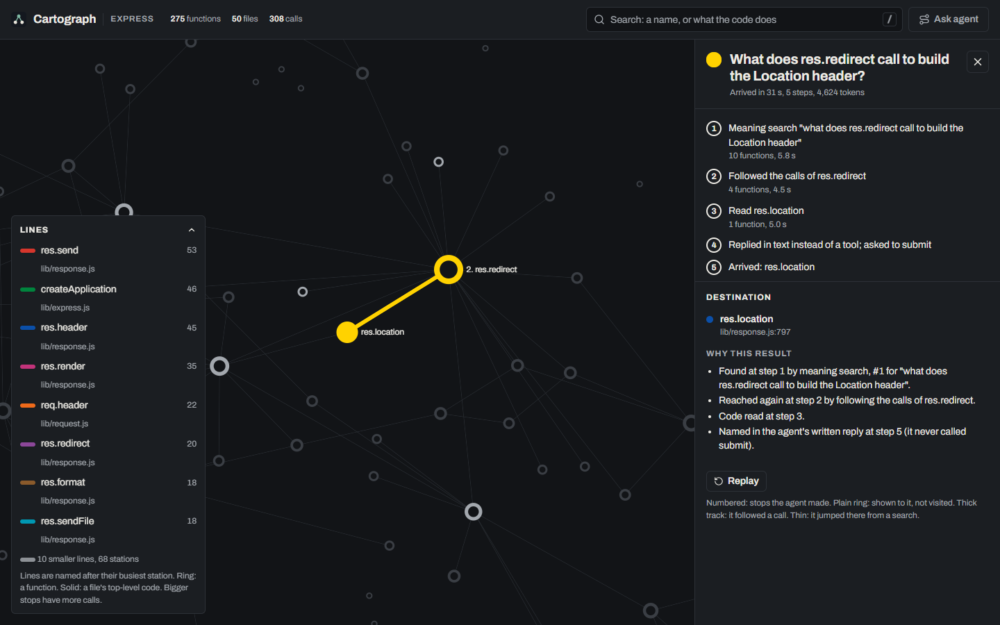

# Cartograph

Ask questions about a JavaScript or TypeScript codebase in plain English and get the exact functions, files and lines that answer them. Watch the search happen on a map of the code, and see why each answer was chosen.



Everything runs on your machine: the index, the search, and a free local AI model. Your source code never leaves it.

## What it does

- **Search by meaning and by name.** Keyword search (BM25) and meaning search (CodeRankEmbed vectors in Postgres + pgvector), merged with Reciprocal Rank Fusion.
- **An agent that looks things up.** A small local model (Qwen3 4B via Ollama) searches, follows calls, reads code, and answers with `file:line`, or says "not found".
- **A map of the code.** Functions are stations and calls are track (Sigma.js, WebGL). Ask a question and the agent's search is drawn as a route, step by step, with the reasons for each result.
- **Impact.** What calls a function (call graph) and what usually changes with it (mined from git history).
- **"Is X always called before Y?"** Branch-aware answers through the call graph, with a call path as proof when the answer is no.
- **An MCP server**, so Claude Code, Cursor and other agents can use all of the above as tools.

## Results

All measured on [Express](https://github.com/expressjs/express) (a small codebase: about 50 source files). Numbers will move to a larger repository (Prettier) before they are treated as headline results. Methods and caveats: [docs/EVALUATION.md](docs/EVALUATION.md).

**Finding code from a bug report** (74 questions from real GitHub issues; the answer is the function the fix changed; Acc@k = a correct function is in the top k):

| Method | Acc@1 | Acc@5 |
|---|---|---|
| BM25 keyword search | 0.31 | 0.70 |
| Hybrid search (BM25 + CodeRankEmbed) | 0.41 | 0.78 |
| Grep-only agent (Qwen3 4B, local) | 0.28 | 0.38 |
| **Cartograph agent (Qwen3 4B, local)** | **0.53** | 0.76 |

Both agents use the same free model on a laptop GPU (RTX 2050, 4 GB) and the same step budget; only their tools differ.

**Other checks:**

| What | Result | Report |
|---|---|---|
| Call graph links that are correct | about 97% (hand sample + agreement with the Jelly analyzer) | [CALLGRAPH.md](eval/express/CALLGRAPH.md) |
| "Is X always before Y?", 35 questions | 33/35 (comparing line numbers: 12/35) | [ORDER.md](eval/express/ORDER.md) |
| Predicting what changes together (top 5) | git history 0.29, call graph 0.05, same-file baseline 0.27 | [IMPACT.md](eval/express/IMPACT.md) |
| Claude Code with Cartograph's MCP tools, 20 issues | no gain on Express: same top-5 accuracy, about 10% more input tokens | [MCP.md](eval/express/MCP.md) |
| Indexing (laptop, CPU) | Express, 141 files: 1.6 s, 0.07 s when nothing changed. Prettier, 5,804 files: 33 s, 1.5 s when nothing changed, 93 MB peak memory | [EVALUATION.md](docs/EVALUATION.md#performance) |

The last two rows are honest negatives and limits: on a six-file library, grep is already good enough. Whether an index pays off on a large repository is the next thing to measure.

## Quick start (Docker)

Needs [Docker](https://docs.docker.com/get-docker/). Optional: [Ollama](https://ollama.com) running locally for the agent (the map, search and impact work without it).

```bash
git clone https://github.com/bhavyammisra/cartograph && cd cartograph
git clone https://github.com/expressjs/express targets/express    # or any JS/TS repo
docker compose up --build                                       # map on http://localhost:8080
```

To map another repository: `REPO=/path/to/repo docker compose up`. The first start indexes the repo and builds meaning vectors on CPU, which takes a few minutes; later starts only re-parse changed files.

## Local development

Needs Python 3.12 via [uv](https://docs.astral.sh/uv/), Node.js 20+ and Docker.

```bash
docker compose up -d db                                   # Postgres + pgvector only
cd engine
uv run cartograph index ../targets/express                # parse functions, calls, imports
uv run cartograph embed ../targets/express                # meaning vectors (CPU)
uv run cartograph serve ../targets/express                # API on http://127.0.0.1:8000 (docs at /docs)
cd ../web && npm install && npm run dev                   # map on http://localhost:5173
```

Other commands: `cartograph ask` (one question from the terminal), `cartograph order` (is X before Y?), `cartograph eval`, `cartograph impact-eval`, `cartograph order-eval`, `cartograph mcp`. Run `uv run cartograph --help` for all of them.

## Use it from Claude Code (MCP)

Add this to a `.mcp.json` in the repository you want to work on:

```json
{"mcpServers": {"cartograph": {"command": "uv", "args": ["run", "--project", "/path/to/cartograph/engine", "cartograph", "mcp", "/path/to/your/repo"]}}}
```

Tools: `search_code`, `get_function` (code, callers, callees, often changed with), `impact`, `check_order`. In our measurement Claude Code only used them when told to, so add a line to your CLAUDE.md such as "This repository is indexed by Cartograph: prefer its MCP tools."

## How it works

[docs/ARCHITECTURE.md](docs/ARCHITECTURE.md) has the diagram and the reasoning behind each part. In short: tree-sitter parses every file into functions and calls; calls are resolved to the functions they reach and labelled with how they were resolved; everything goes into Postgres with pgvector; FastAPI serves search, the call graph, impact, ordering and a live stream of the agent's steps; the React map draws it all with Sigma.js.

## Project layout

```
engine/   Python: parser, resolver, search, agent, ordering, API, MCP server
web/      TypeScript + React: the map
eval/     questions, gold answers and every result file
scripts/  screenshot capture and the Claude Code measurement
docs/     architecture, evaluation, progress, learning log
```

## Contributing

See [CONTRIBUTING.md](CONTRIBUTING.md). Changes are listed in [CHANGELOG.md](CHANGELOG.md).

## License

MIT
